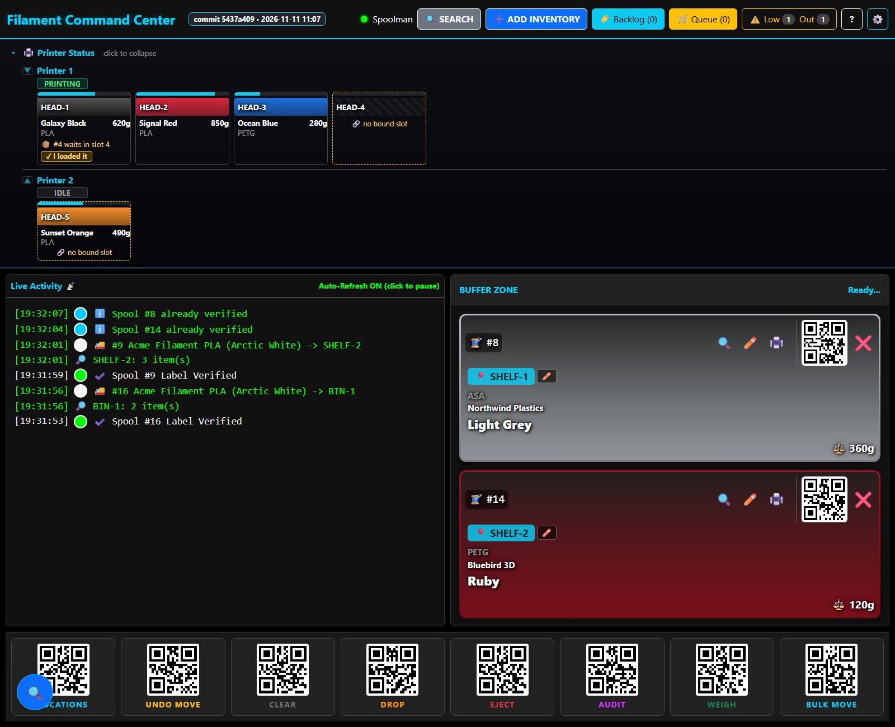
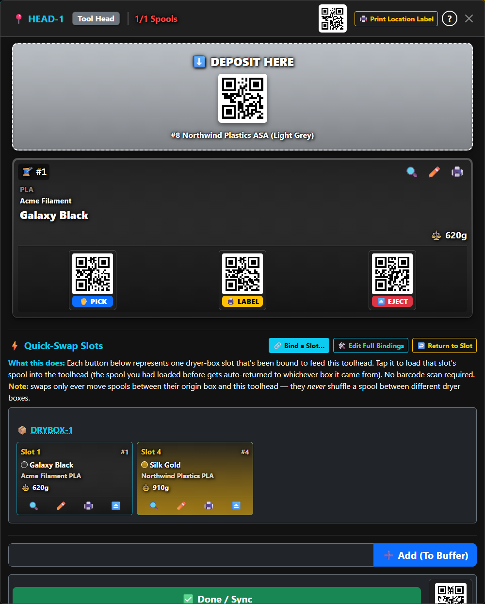
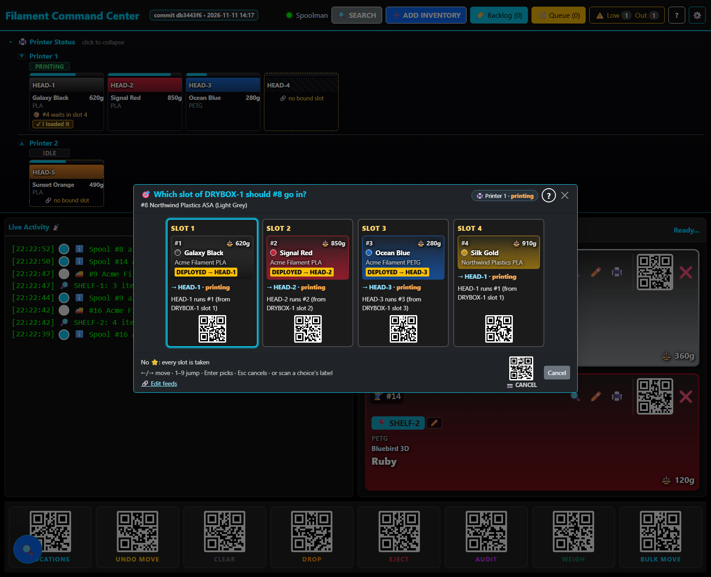
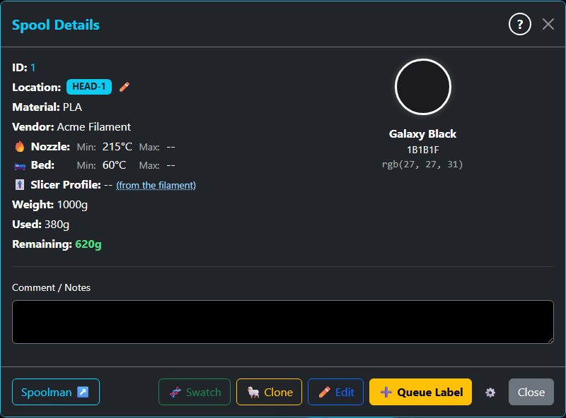
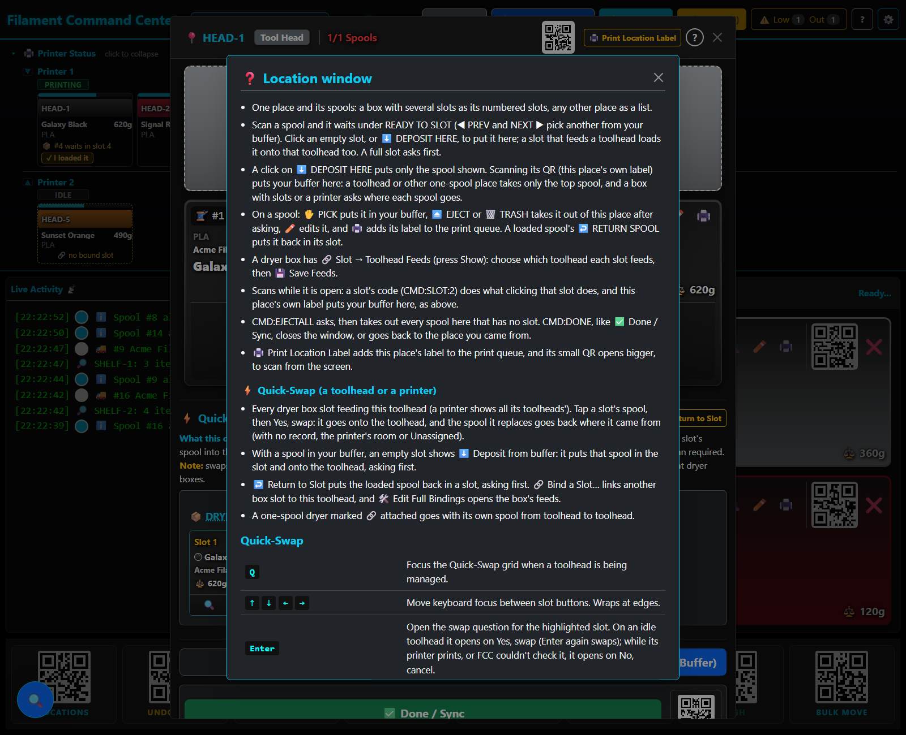

# Filament Command Center

Filament Command Center (FCC) keeps track of every spool of 3D-printer filament: where it is, what is loaded on each printer, and how much is left on it. It works on top of [Spoolman](https://github.com/Donkie/Spoolman), which stores the spools, and is run mostly with a barcode scanner: scan a spool's label, then the label of the place it goes, and FCC moves it there.

*The pictures show a demo setup with made-up spools and places, taken 2026-11-11.*

## What it needs

- **Spoolman**, which holds the spools, filaments and brands (FCC runs against 0.27). FCC keeps its own list of places, boxes and printers in `inventory-hub/data/locations.json`.
- **Docker**: FCC is one container (Python and Flask). The live copy runs on a TrueNAS server.
- **A barcode scanner** that types like a keyboard. Every label FCC makes is a QR code.
- Optional: **Prusa printers with PrusaLink**, for each printer's state and the filament each print used, and a **Brother P-touch** label printer with P-touch Editor.

## Everyday use

### Scan a spool, then where it goes

Scan a spool's label and it joins the **Buffer Zone**. Then scan a place's label (a shelf, a bin, a box): FCC moves every spool in the buffer there and writes it to Spoolman. Scan several spools first to move them together. **Live Activity** and a toast say what happened. **UNDO MOVE** puts the last move back, after asking.

### Boxes, slots and printers

A dryer box has numbered slots, and each slot has its own label. A slot can feed one of a printer's toolheads: open the box from **LOCATIONS** and set it under **🔗 Slot → Toolhead Feeds**. Scan a spool, then a slot's label: FCC puts the spool in that slot and, when the slot feeds a toolhead, loads it onto that toolhead. Before it takes another spool off a toolhead, or touches a printer that is printing, it asks: **Load it instead**, **Just store it** or **Cancel**.

### Quick-Swap and Return

Open a toolhead from **LOCATIONS**: its **⚡ Quick-Swap** grid shows every box slot that feeds it. Tap a slot (or move with the arrow keys and press Enter) to swap that slot's spool onto the toolhead. **↩️** on a loaded spool's card returns it to the box slot it came from, and asks which slot when that isn't clear.

### Weigh

**WEIGH** opens the weigh-out list: scan a spool, type what the scale reads, press Enter. **Gross**, **Net**, **Additive** and **Set Used** say what the number means. A spool weighed down to nothing is archived, unless **Auto-Archive 0g** is off. The ⚖️ weight on a spool's card opens the Quick-Weigh for that one spool.

### Labels

🖨️ on a spool, a filament or a place adds its label to the **Queue**. The queue writes CSV files, and P-touch Editor prints from them: its label templates read the CSVs as their database. **🏷️ Backlog** lists what still needs a label, and scanning a printed label confirms it.

### Printers and what each print used

**Printer Status** shows each printer's state and the spool on each toolhead. When a print finishes, FCC reads the print file from PrusaLink and takes the filament each toolhead used off its spool. A cancelled or unclear print opens a 🛑 review, so you decide what to charge.

### Audits and low stock

**AUDIT** checks one place: scan its label, then every spool you find there. **Done** says what is missing and what doesn't belong before it moves anything. **⚠️ Low / Out** in the title bar counts the filaments running low or out, and opens the list.

## Help inside the app

Each everyday window has a **?** button in its header. It opens that window's help: what the window is for, what its buttons and scans do, and its keys. The **?** key does the same for the window on top (outside a text box), and pressing it again lists every keyboard shortcut and scan command. With no window open, **?** lists them all.

## Running it

- **Dev:** in `inventory-hub/`, `docker compose up -d`, then open http://localhost:8000. It needs `config.json` one folder up (copy `config.json.example`: Spoolman's address and port) and `inventory-hub/.env` (copy `.env.example`: where the label CSVs go).
- **Live (TrueNAS):** a release is `dev` merged into `main`. `update.sh` runs on the TrueNAS server: it backs up Spoolman, pulls `main`, runs `setup-and-rebuild/setup_fields.py` (Spoolman's extra fields) and restarts the app. It stops, and sends an email, when the Spoolman backup fails.
- **Tests:** see the Testing section of [CLAUDE.md](CLAUDE.md) (pytest and Playwright on the host; `--offline` for a run that writes nothing).

## Where things are

- `inventory-hub/`: the app. The backend is the Python modules at its top level, and the page is in `static/js/modules/` and `templates/`.
- `inventory-hub/data/locations.json`: places, boxes, printers and their toolheads (not in git; `locations.json.example` shows the shape).
- `config.json`: Spoolman's address and FCC's settings (not in git).
- `setup-and-rebuild/`: Spoolman's field setup, migrations and the dev reset.
- [Feature-Buglist.md](Feature-Buglist.md): what is planned and known. It opens with **⏸️ PENDING DEREK**, the hands-on checks only the owner can do; nothing there holds up a release.
- `docs/agent_docs/`: the working groups and the task file behind each change.
- [DESIGN.md](DESIGN.md): the dashboard's look. [CLAUDE.md](CLAUDE.md): the rules every change follows.
